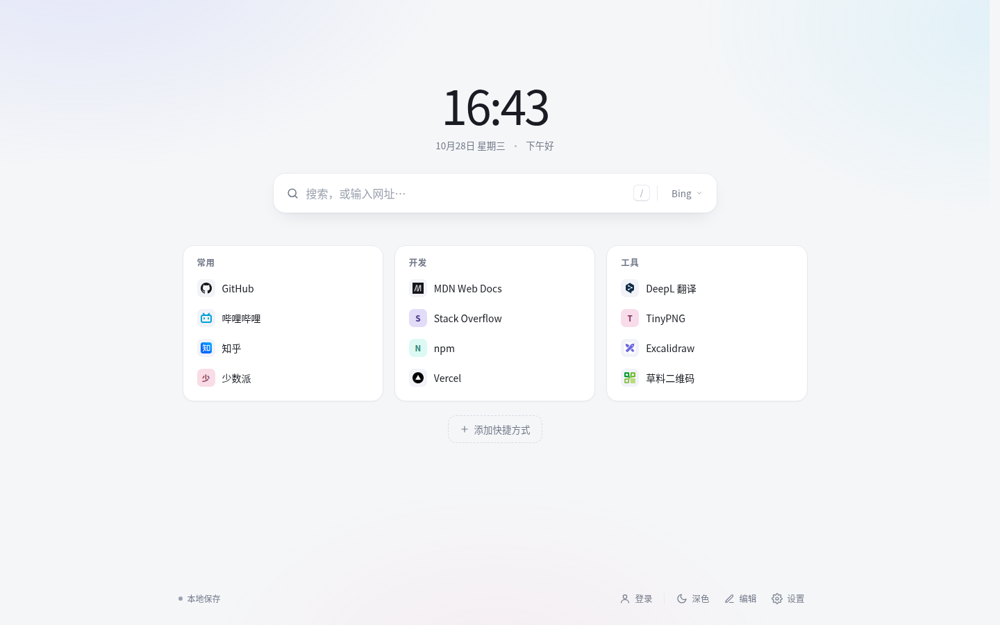
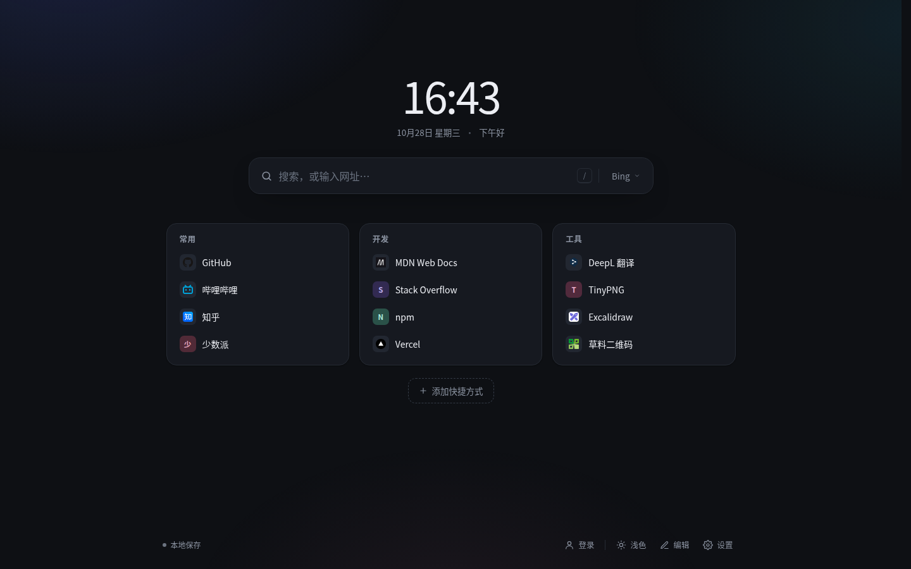
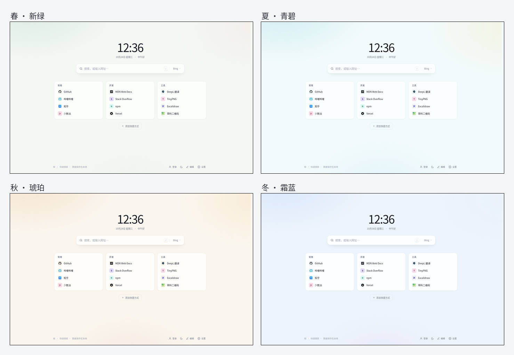
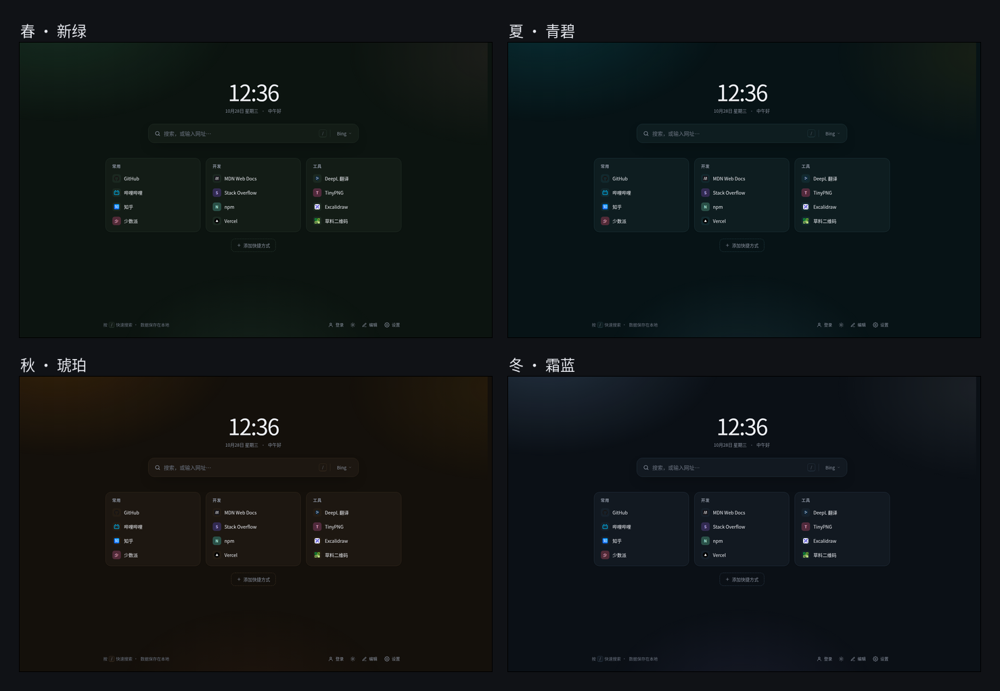
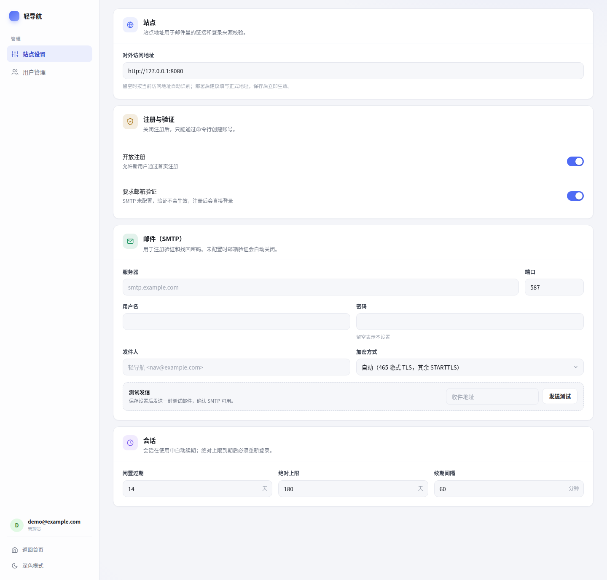

# 氢导航

[](https://github.com/xiaoxura/qingdh/actions/workflows/ci.yml)
[](LICENSE)

一个简洁的浏览器起始页：快速搜索、快捷方式分组、深浅色与四季配色，可选登录后在多台设备之间同步。

**技术栈**：Go 1.24 + PostgreSQL + 原生 HTML/CSS/JS。前端通过 `go:embed` 打进单个二进制，没有 Node 构建步骤。

文档：[后端设计](docs/backend-design.md) · [客户端加密](docs/encryption.md) · [开发记录与路线图](docs/next-round.md) · [贡献指南](CONTRIBUTING.md) · [安全策略](SECURITY.md)

- **游客模式**：不登录也能完整使用，数据只保存在本机浏览器里。
- **账号同步**：邮箱注册，Go 单二进制 + PostgreSQL 自托管；登录后自动同步，冲突时由你选择合并方式。
- **零依赖前端**：纯 HTML / CSS / 原生 JS，没有构建步骤。
- **部署简单**：一个 `config.yml` + 一个二进制文件即可启动；运行期设置在 `/admin` 管理后台修改。



<details>
<summary>深色预览</summary>



</details>

## 特性

- **搜索即地址栏**：关键词走搜索引擎，内置 Bing、Google、百度、DuckDuckGo 和秘塔，也支持在设置中新增自定义引擎；输入 `github.com` 这样的地址直接打开，`!g`、`!bd`、`!mt` 等前缀可临时切换，不改变默认引擎。输入时可直接检索本地快捷方式、分组和已解锁备忘录，方向键选择后回车打开；未选择建议时保留原搜索行为，输入不会自动发送给 AI。网页和 AI 搜索历史都只保存在本机，支持关键词与类型筛选，AI 缓存答案与重新搜索分别操作。
- **可隐藏侧栏**：首页/备忘录/搜索历史、主题、编辑、设置、同步与账号都收进侧栏，支持左右位置切换、展开、图标栏、完全隐藏和移动端抽屉。
- **编辑式时钟**：衬线艺术字 + 四季渐变，默认按当前月份自动切换春/夏/秋/冬配色；支持极简样式、12/24 小时和显示秒。
- **快捷方式**：分组管理，支持添加、编辑、删除、重命名分组、移动链接；分组可折叠并记住状态，支持舒适/紧凑密度；删除链接 6 秒内可撤销；批量整理可多选移动、删除并检查重复 URL。快捷方式图标经同源 `/api/favicon` 代理并缓存，避免每次打开首页都把整份书签列表直接暴露给各站点。
- **备忘录**：未登录或未开启主加密时保存在本机（IndexedDB + 本机密钥加密）；登录并开启加密后自动合并到云端，服务端只存密文。支持 Markdown、任务清单、标签、置顶/归档、提醒、双向链接与导出；整理模式支持多选、按当前筛选全选、批量归档/取消归档、加标签与删除，编辑器显示总容量并在接近上限时提醒。
- **AI 搜索**：DeepSeek 先调用官方 Search API 检索网页，再把结果交给对话模型生成带来源的回答；AI 搜索在新标签页打开独立的 `/ai` 结果页，回答支持 Markdown 排版、`[1]` 引用跳转和带序号的来源列表。模型列表和账户余额也通过官方接口读取；支持 OpenAI 兼容直连。密钥加密同步且不回显，秘塔目前作为网页搜索引擎。
- **隐私空间**：独立密码 + 独立密钥的私密分组/链接与备忘录，快捷键打开、自动锁定，不进入普通工作区、搜索或管理后台。
- **设置与账号**：统一居中弹窗，分为「账号与设备 / 外观与布局 / 搜索与 AI / 同步与数据 / 安全与隐私」五类，关联内容在同页分节显示。
- **调用概览**：按供应商显示服务端代理的调用次数、错误、输入/输出 Token、最近调用和账户余额；后续接入其他 AI 渠道时沿用同一页面。
- **同步管理**：快捷方式/分组、站点设置可以单独勾选是否参与云端同步，同时显示云端与本地同步项数量、自动同步开关、冲突合并和墓碑删除规则；冲突弹窗显示新增、修改、删除的实际差异；加密模块在页面中单独标注。
- **命令面板**：`Ctrl/⌘ + K` 搜索网页、问 AI、新建/打开备忘录、打开隐私空间、设置与主题；分组结果可跳转并高亮，备忘录正文和标签也参与检索并显示命中摘要；隐私内容不进入索引。AI 搜索会在新标签页打开独立结果页。
- **设备信任**：Device Vault 默认“记住此设备”，可用 Touch ID / Windows Hello 等 Passkey 解锁本机 vault，密码始终可回退。
- **PWA 与书签导入**：可安装、离线打开 app shell；支持 Netscape 书签 HTML 的预览、去重与导入。
- **深浅色 + 四季配色**：明暗可跟随系统，另有春、夏、秋、冬四套配色，手动切换。
- **账号与同步**：邮箱注册与验证、会话自动续期、多设备同步、冲突合并、登录设备管理、导出与删号；内置头像库按账号稳定分配（DiceBear Thumbs，CC0）。
- **可选客户端加密**：云端只存密文，忘记密码可用恢复码找回；管理员查看也需要用户提供加密密码。
- **管理后台**：数据概览页 + 分组后的「用户管理 / 站点 / 注册与邮件 / 会话与 AI」设置；站点页可配置站点名称和 Logo（URL 或上传），用户列表显示每人云端数据数量；配置先展示已保存值摘要，通过编辑弹窗分组修改；取消不保存，失败保留输入。危险操作使用站内确认弹窗。保存后立即生效，不需要重启。
- **数据本地优先**：所有修改先写本地，联网后自动同步；离线也能正常编辑。

## 四季配色



<details>
<summary>深色版本</summary>



</details>

配色只改变颜色与背景光晕，不改变布局、字号和交互。明暗与风格属于设备偏好，单独保存在本地，不会写入导出的导航数据，也不参与账号同步。

## 快速开始（二进制 + config.yml）

需要 Go 1.24+ 和 PostgreSQL 16+。

```bash
git clone https://github.com/xiaoxura/qingdh.git qingdh && cd qingdh
go build -o qingdh ./cmd/qingdh

cp config.example.yml config.yml
chmod 600 config.yml        # 里面包含数据库密码
# 编辑 config.yml 的 database 字段

./qingdh serve -config config.yml
```

打开 `http://localhost:8080` 即可使用。首次启动会自动建表。

启动后建议先到 `/admin` 填写「站点地址」，邮件里的验证 / 重置链接会使用它；留空时按访问地址自动推断。

创建第一个账号并设为管理员：

```bash
./qingdh user create you@example.com   # 终端输入密码，邮箱直接视为已验证
./qingdh admin grant you@example.com
```

然后登录首页，账号菜单里会出现「管理后台」，或直接访问 `http://localhost:8080/admin`。

配置路径也可以通过 `QINGDH_CONFIG` 指定；不带 `-config` 时默认读取当前目录的 `config.yml`。

### 常用命令

```bash
./qingdh serve [-config path]          # 启动服务
./qingdh migrate [-config path]        # 只执行数据库迁移
./qingdh user create <email>           # 创建已验证账号（终端输入密码）
./qingdh user passwd <email>           # 重置密码并撤销该用户全部会话
./qingdh admin grant <email>           # 设为管理员
./qingdh admin revoke <email>          # 取消管理员
./qingdh version
```

## 管理后台



`/admin` 需要管理员账号，普通用户会被拒绝。可以修改：

- **站点地址**：用于邮件链接和登录来源校验；留空时按访问地址自动识别。
- **注册与验证**：是否开放注册、注册是否需要邮箱验证。
- **SMTP**：服务器、端口、用户名、密码、发件人、加密方式，以及发送测试邮件。
- **用户数据**：在「用户管理」里点「查看」，可以看到该用户的分组和分组下的链接；如果对方开启了加密，需要输入用户提供的加密密码，密码只在管理员浏览器里使用。
- **会话**：闲置过期时间、绝对上限、续期间隔。

保存后立即生效，多个实例最多 30 秒内同步到最新设置。SMTP 未配置时，邮箱验证会自动失效并在后台给出提示。

以下内容仍然在 `config.yml` 中，因为它们决定进程如何启动：

| 配置项 | 默认值 | 说明 |
| --- | --- | --- |
| `server.listen` | `:8080` | 监听地址 |
| `server.trusted_proxies` | 空 | 信任的代理 CIDR，用于解析客户端 IP 和 HTTPS 协议 |
| `server.trusted_hosts` | 空 | 可信对外域名（可带端口）；配置后拒绝其他 Host，并用于邮件链接 |
| `server.metrics_token` | 空 | 配置后启用 `GET /metrics`（Prometheus 文本），留空则接口不存在 |
| `database.host` | 必填 | PostgreSQL 主机 |
| `database.port` | `5432` | PostgreSQL 端口 |
| `database.user` | 必填 | 数据库用户 |
| `database.password` | 空 | 数据库密码 |
| `database.name` | 必填 | 数据库名 |
| `database.sslmode` | `prefer` | `disable` / `allow` / `prefer` / `require` / `verify-ca` / `verify-full` |
| `database.max_conns` | `10` | 连接池上限 |
| `database.migrate_on_start` | `true` | 启动时自动迁移 |
| `log_level` | `info` | `debug` / `info` / `warn` / `error` |
| `web_dir` | 空 | 开发时从磁盘读取 `web/`（相对路径基于配置文件目录） |

完整示例见 [`config.example.yml`](config.example.yml)。

## 账号与同步

### 注册与邮箱验证

- 默认要求邮箱验证：注册后发送验证邮件，**不会立即登录**；点击邮件里的链接会先打开确认页，再点「确认验证」后服务端才消费 token、签发会话并跳回首页。这样邮件安全网关/链接预览不会提前用掉一次性链接。
- 在管理后台关闭验证后：注册即登录，账号直接视为已验证。
- 没有配置 SMTP 时验证自动关闭；此时只能用命令行管理账号。
- 忘记密码通过邮件重置；重置成功后所有设备退出登录。没有 SMTP 时用 `qingdh user passwd`。

### 会话

- 默认滑动过期：闲置 14 天失效，使用中自动续期，最长不超过 180 天。
- 续期最多每小时写一次库；续期只延长时间、不轮换 token，避免多标签页互相顶掉。
- 登录、改密、重置密码时才轮换或撤销会话。
- 同一浏览器通过长期设备 Cookie 识别：重复登录会替换该设备的会话，不会在设备列表里越堆越多；登录设备里显示最近活跃时间和 IP。
- 可以在「账号 → 登录设备」里查看设备并单独退出。
- 闲置/绝对/续期时长都可以在管理后台调整。

### 多设备同步

- 所有修改先写本地，800ms 防抖后推送；窗口重新聚焦、恢复联网时也会同步。
- 服务端用 `revision` 乐观锁：版本不一致返回 409 和云端最新数据。
- 冲突时弹窗让你选择：**合并**（默认）、仅用本地、仅用云端、稍后。
- 合并按 id 比较 `updatedAt`，删除用墓碑（`deletedAt`）记录，避免删除被另一台设备复活；同一分组内按网址去重。
- 首次在新设备登录时，如果本地没有改动会直接拉取云端；如果游客模式改过数据则会询问如何合并。
- 明暗、风格、打开方式属于设备偏好，不会同步；昵称和默认搜索引擎会同步。

### 数据加密（可选）

账号菜单里可以给云端数据单独设置一个**加密密码**（与登录密码相互独立）：

- 只有密文上传到服务端，数据库、备份和管理员默认都看不到分组和链接。
- 使用 PBKDF2-SHA256（600,000 次）派生密钥，AES-256-GCM 加密；随机数据密钥由密码包裹，修改加密密码只重新包裹密钥，不会重新加密全部链接。
- 开启时会显示一次**恢复码**，必须离线保存；忘记密码时用它解锁并重置加密密码。
- 新设备、无痕窗口或关闭标签页后重新打开，需要输入加密密码或恢复码；同一个标签页刷新会使用 `sessionStorage` 里的缓存，不反复询问。
- 后台查看加密用户的数据时，也需要输入该用户的加密密码；密码不会发送到服务端。
- 导出会得到加密 envelope 文件；导入时提示输入密码或恢复码。
- 需要 HTTPS 或 localhost（浏览器 WebCrypto 只在安全上下文可用）。纯 HTTP 局域网无法开启加密。

### 加密备忘录、AI 配置与隐私空间

开启主加密后，以下能力才会把内容同步到云端；服务端、备份和管理员都只看到密文：

- **备忘录**（v4 `kind=memo`）：登录并开启主加密后，使用主数据密钥经 HKDF 派生的子密钥加密，AAD 带用途，memo 密文不能当 AI 密文解开。未登录/未加密时使用 IndexedDB 中的 non-extractable AES-GCM 本机密钥加密保存，不上传；开启加密后自动合并到云端并清除本机副本。支持 Markdown 预览、任务清单、标签、置顶/归档/提醒/双链和 Markdown/JSON 导出；导出文件是明文，会先提示。
- **AI 配置与密钥**（v4 `kind=ai`）：整份 provider 配置加密上传，API Key 永远不回显完整值。网页型供应商不需要密钥（当前秘塔已移到搜索引擎，AI 网页型后续再接入）；API 型由服务端固定上游代理并以 SSE 流式返回，密钥只随单次请求进入内存，不落库、不写日志；也支持浏览器直连（需 CORS，且密钥会出现在浏览器网络面板）。
- **隐私空间**（v4 `kind=privacy`）：独立密码、独立 `dataKey` 和独立恢复码，不写入 Device Vault，每次进入都验证密码；支持快捷键（默认 `Alt+Shift+P`，可在设置里改）、3 分钟空闲自动锁定、标签页隐藏 30 秒自动锁定，以及锁定后清空 DOM 和内存密钥。隐私内容不进入普通工作区、导出、搜索或管理后台。
- **Device Vault**：首次解锁时默认勾选“在此设备上记住解锁”，用 IndexedDB 中不可导出的 deviceKey 包裹主 dataKey；退出登录或“忘记此设备”会清除。可再启用 Passkey（Touch ID / Windows Hello）作为本机 vault 的门禁，取消或失败时始终回退加密密码。

需要注意：

- 本地浏览器存储和本地快照仍是明文，加密保护的是云端和备份；共用电脑请自行清理浏览器数据。
- 开启加密**不会**清理历史备份；升级前的备份里可能仍有明文。
- 忘记加密密码且丢失恢复码 = 云端数据无法恢复。
- 忘记隐私密码且丢失隐私恢复码 = 隐私空间无法恢复，但普通数据不受影响。
- 加密后的导航文档上限为 512 KiB（Base64 膨胀后的限制）；备忘录整体另有约 360 KiB 明文预算，超过时会提示精简。
- AI 代理的每日额度在管理后台配置，默认 200 次/天，另有每用户 10 次/分钟限制；额度按当日成功调用统计并保存在数据库里，重启或多实例不会重置/翻倍；费用由用户自己的 API Key 承担。模型下拉通过 DeepSeek `GET /models` 刷新，余额通过 `GET /user/balance` 查询，调用概览记录每次代理调用的 Token 与耗时。
- Device Vault 和 Passkey 提高便利性，但降低了“设备被盗”时的保护；它们防的是服务端/备份泄露和普通旁观，不防设备被入侵、恶意扩展或键盘记录器。

完整设计和威胁模型见 [客户端加密设计](docs/encryption.md)。

### 数据与备份

- 游客数据：`qingdh.data.v1:guest`
- 账号缓存：`qingdh.data.v1:user:<id>`
- 同步元数据：`qingdh.sync.v1:user:<id>`
- 设备偏好：`qingdh.prefs.v1`（含侧栏、时钟、隐私快捷键）
- Device Vault / Passkey：IndexedDB `qingdh.vault.v1`、`qingdh.passkey.v1`（只在本机，不上传）
- 提醒去重：`qingdh.memo.notified.v1`
- 合并或覆盖前会在本机留一份快照，设置里可以「恢复备份」。快照按账号归属校验，其他账号不可恢复；旧版无归属快照不会自动归入当前账号。
- JSON 导入先预览，默认合并并保留当前设置与已有条目，也可明确选择替换；超出数量或容量限制时阻止导入。
- 导出：设置 → 导出 JSON（本地）或账号 → 导出数据（云端）。
- 服务端备份：`pg_dump -Fc qingdh > qingdh-$(date +%F).dump`，恢复用 `pg_restore -d qingdh`。

## 可选：Docker

Docker 不是必需的，只是给需要的人提供一个镜像。镜像同样使用 `config.yml`：

```bash
docker build -t qingdh .
docker run -d --name qingdh \
  -p 127.0.0.1:8080:8080 \
  -v "$PWD/config.yml:/etc/qingdh/config.yml:ro" \
  qingdh
```

数据库可以是容器外的 PostgreSQL，也可以是同机容器；按 `config.yml` 里的 `database.host` / `database.port` 连接即可。

注意：容器内监听地址要写 `:8080`（不要写 `127.0.0.1:8080`），并且挂载的 `config.yml` 需要对容器用户（uid 65532）可读。

## 纯前端预览

`web/` 是完整的静态目录，可以由任意静态服务器托管，用于查看界面：

```bash
python3 -m http.server 8080 --directory web
# 打开 http://localhost:8080
```

登录、同步、AI、管理后台和 favicon 代理都依赖 Go 服务端；完整功能请按上面的方式启动。

## API

统一前缀 `/api/v1`，JSON 请求与响应，Cookie 会话；完整设计见 [后端设计草案](docs/backend-design.md)。

```text
POST   /auth/register            POST /auth/login          POST /auth/logout
GET    /auth/me                  POST /auth/refresh
POST   /auth/verify-email        GET  /verify-email?token=
POST   /auth/resend-verification POST /auth/forgot-password
POST   /auth/reset-password
GET    /auth/sessions            DELETE /auth/sessions/{id}
POST   /auth/logout-all
DELETE /account                  GET  /account/export
GET    /workspace                PUT  /workspace

GET    /secrets/{kind}           PUT  /secrets/{kind}      # kind: ai | memo | privacy
POST   /ai/chat                  POST /ai/test             # 密钥仅本次请求，SSE 流式

GET    /admin/settings           PUT  /admin/settings
POST   /admin/settings/test-email
GET    /admin/users              PATCH /admin/users/{id}
DELETE /admin/users/{id}

GET    /healthz                  GET  /readyz
GET    /api/favicon?u=<origin>   GET  /metrics（可选，Bearer token）
```

`/secrets/{kind}` 只存 v4 密文，kind 由服务端白名单固定；管理后台没有读取 secret 的接口。AI 代理只接受服务端 allowlist 中的供应商和固定上游地址，不根据客户端输入拼接 URL。

## 快捷键

| 按键 | 作用 |
| --- | --- |
| `/` | 聚焦搜索框 |
| `Ctrl/⌘ + K` | 打开命令面板（搜索、AI、备忘录、设置、隐私入口） |
| `Esc` | 清空搜索；关闭面板/答案；编辑模式下退出编辑 |
| `Ctrl/⌘ + Shift + M` | 快速记录一条备忘录（未登录时存本机） |
| `Alt + S` 或 `Ctrl/⌘ + Shift + .` | 展开/收起/显示侧栏 |
| `Alt + Shift + P` | 打开隐私空间（可在设置里改键） |
| `!b` / `!g` / `!bd` / `!d` | 本次用 Bing / Google / 百度 / DuckDuckGo 搜索 |
| 直接输入 `github.com` | 打开网址而不是搜索 |

## 设为浏览器启动页

**Chrome / Edge**：设置 → 外观 → 显示「主页」按钮 → 自定义主页，填入地址；启动时打开则在「启动时」配置。

> Chrome 不允许直接把自定义页面设为「新标签页」。要替换新标签页需要装扩展（例如 New Tab Redirect）并指向本页；作为主页或启动页则不需要。

**Firefox**：设置 → 主页 → 自定义网址。

## 开发与测试

开发记录与路线图见 [docs/next-round.md](docs/next-round.md)；加密细节见 [docs/encryption.md](docs/encryption.md)，后端接口见 [docs/backend-design.md](docs/backend-design.md)，可靠性加固记录见 [docs/reliability.md](docs/reliability.md)。

```bash
gofmt -l .                 # 应无输出
go vet ./...
go test -race ./...
CGO_ENABLED=0 go build -trimpath -o /tmp/qingdh ./cmd/qingdh

for f in web/*.js web/lib/*.js; do node --check "$f"; done
node --test web-tests/unit/*.test.mjs
node web-tests/reliability.mjs  # 需本地服务 + Chrome，见 web-tests/README.md
```

集成测试默认使用 [embedded-postgres](https://github.com/fergusstrange/embedded-postgres) 启动临时数据库（首次运行会下载二进制并缓存），不依赖 Docker。也可以指向本机已有的 PostgreSQL：

```bash
TEST_DATABASE_URL="postgres://postgres@127.0.0.1:5432/postgres?sslmode=disable" go test ./...
```

注意：测试会 `DROP SCHEMA public CASCADE` 重建 schema，请使用专用数据库，不要指向生产库。

前端没有构建步骤。开发时可以设置 `web_dir: "web"` 从磁盘读取 `web/index.html` / `web/app.js` / `web/assets`，改完刷新即可；管理后台同目录。

## 文件结构

```text
qingdh/
├── web/                                             # 前端（go:embed 根目录）
│   ├── index.html / boot.js / styles.css / app.js   # 用户端页面
│   ├── select.js / select.css                       # 自定义下拉框（保留原生 select）
│   ├── crypto.js                                    # 客户端加密（v3 工作区 + v4 secrets）
│   ├── device-vault.js / passkey.js                 # 本机记住解锁 / WebAuthn 门禁
│   ├── secrets.js                                   # /secrets 同步与冲突处理
│   ├── memo.js / ai.js / privacy.js                 # 备忘录 / AI / 隐私空间
│   ├── command-palette.js / bookmarks.js            # 命令面板 / 书签导入
│   ├── avatars.js                                   # DiceBear Thumbs 头像库（CC0，预渲染）
│   ├── pwa.js / manifest.webmanifest / service-worker.js / assets/
│   ├── admin.html / admin.js / admin.css            # 管理后台
│   └── lib/core.js                                  # 纯函数（浏览器 + node:test 共用）
├── assets.go                                        # go:embed web/ 入口
├── config.example.yml                               # 启动配置示例
├── cmd/qingdh/                                      # serve / migrate / user / admin
├── internal/
│   ├── config/       # config.yml 解析与校验
│   ├── settings/     # 运行时设置（数据库 + 缓存）
│   ├── auth/         # Argon2id、token、会话管理
│   ├── store/        # pgx 查询
│   ├── httpapi/      # 路由、中间件、handler
│   ├── docval/       # 导航数据校验
│   └── mail/         # SMTP 与邮件模板
├── migrations/       # 内嵌 SQL 迁移
├── docs/             # 截图、后端设计与加密设计
└── Dockerfile        # 可选
```

## 安全说明

- 密码使用 Argon2id 存储；会话 token 只存 SHA-256。
- Cookie 为 `HttpOnly` + `SameSite=Lax`；HTTPS 请求下自动使用 `__Host-` 前缀与 Secure。
- 反向代理终止 TLS 时，把代理地址加入 `server.trusted_proxies`，并让代理设置 `X-Forwarded-Proto`；否则服务端会把请求当成 HTTP，限流也会按代理 IP 合并。配置了 HTTPS 站点地址时，服务端会据此把 Cookie 标记为 Secure 并发送 HSTS；启动日志会在缺少 `trusted_proxies` 时告警。
- 公网部署建议设置 `server.trusted_hosts`（或在 `/admin` 设置站点地址），避免伪造 Host 影响邮件里的验证/重置链接。
- 非 GET 请求校验 `Origin`/`Referer` 并要求 JSON。
- 登录、注册、发信、secret 写入与 AI 代理均限流；AI 代理另有每用户每日额度。
- 服务端 `user_secrets` 只存 v4 密文，没有管理员读取接口；AI 代理日志不记录请求体、密钥或上游响应。
- service worker 只缓存 app shell，不缓存 `/api/`、`/admin`、隐私或 AI 响应。
- 可选 Prometheus 指标：在 `config.yml` 设置 `server.metrics_token` 后通过 `GET /metrics`（`Authorization: Bearer <token>`）读取；不设置时接口不存在。指标只含方法/状态计数和数据库连接池，不含路径、用户或内容。
- 登录失败统一提示，避免账号枚举；忘记密码始终返回相同结果。
- 管理接口要求管理员会话；管理员不能取消自己的权限、禁用或删除自己。
- 严格 CSP，不加载第三方脚本；图标只取站点自身 favicon。
- 默认情况下服务端可读导航数据；可以在账号里开启客户端加密，开启后服务端、备份和管理员都只看到密文。网页端的加密只能防“诚实但好奇”的服务端和备份泄露，不能防御服务端恶意替换前端 JS。
- `config.yml` 含数据库密码，请限制文件权限，不要提交到仓库。
- 加密是客户端完成的；服务端只看到 v3 envelope。启用加密后，建议重新生成备份，避免旧备份继续保留明文。
- SMTP 密码保存在数据库的 `settings` 表中（需要用它发信），请保护好数据库备份。

## 贡献

欢迎提交 Issue 和 PR。开发环境、测试命令和提交约定见 [CONTRIBUTING.md](CONTRIBUTING.md)。安全问题请按 [SECURITY.md](SECURITY.md) 私下报告，不要公开披露细节。

## License

本项目以 [MIT License](LICENSE) 开源，© 2026 XiaoXuRa。

内置头像来自 DiceBear Thumbs（CC0）；搜索引擎和第三方站点图标归各自权利人所有。
